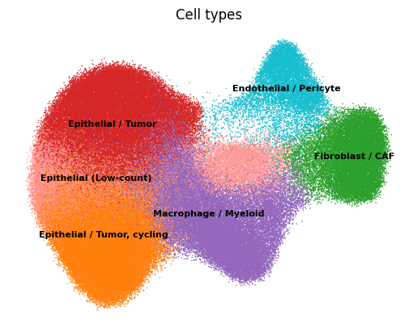
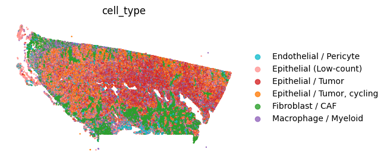
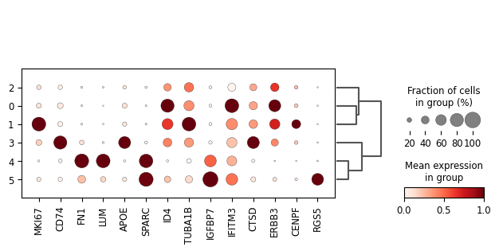

# Xenium Basic Analysis

A notebook that takes a 10x Genomics Xenium dataset from the raw output bundle to a first-pass cell type annotation. The data is the public Xenium V1 human ovarian cancer FFPE sample (base panel plus add-on, 480 genes, about 248,000 segmented cells).

This is a demonstration of the basic steps and a starting point for a larger pipeline. It is not a full analysis of the sample.

## What the notebook does

1. Loads the Xenium bundle with spatialdata and caches it as zarr.
2. Checks background using the negative control probes and codewords, then filters cells (at least 20 transcripts).
3. Normalises to the median transcript count, runs PCA, neighbours, UMAP and Leiden clustering.
4. Merges tiny Leiden clusters into their best-connected large cluster.
5. Finds marker genes (Wilcoxon) and cross-checks them against canonical markers.
6. Tests whether the three epithelial clusters really differ once sequencing depth is matched.
7. Annotates the clusters and runs a signature score consistency check.

## Findings

- Background is very low: negative control probes are 0.005% of gene counts and unused codewords 0.002%.
- A typical cell has about 55 transcripts from about 40 genes. The 20-transcript cutoff removes 12% of cells and leaves 217,402.
- Six cell populations came out of the clustering:

| Label | Share of cells | Main evidence |
|---|---|---|
| Epithelial / Tumor | 30.0% | EPCAM, KRAS, SOX17, ESR1 |
| Epithelial / Tumor, cycling | 22.4% | same genes plus MKI67 and TOP2A |
| Epithelial (Low-count) | 17.3% | weaker epithelial signal, no markers |
| Macrophage / Myeloid | 17.0% | CD74, APOE, CD163 |
| Fibroblast / CAF | 8.6% | FN1, LUM, SPARC, ACTA2 |
| Endothelial / Pericyte | 4.8% | PECAM1, CD34, RGS5 |

- Cycling and non-cycling tumour cells differ in a real cell-cycle program (MKI67, TOP2A, CENPF, UBE2C, CDK1, CCNB2), even after downsampling every cell to the same depth. Proliferating cells are spread through the tumour rather than confined to one zone.
- Fibroblasts and vascular cells fill the lower part of the section and the strands between tumour regions.
- Lymphocyte markers (PTPRC, CD3E, CD8A, MS4A1) are nearly absent in every cluster.

## Limitations

- The annotation is cluster-level and based on a small marker panel. There is no reference-based or independent validation.
- The low-count epithelial cluster is tentative. It has a median of 45 transcripts, no marker gene passes the filter, and it sits along tissue edges. It is probably a mix of low-quality epithelial cells and boundary cells.
- Most of the myeloid cluster also expresses EPCAM, likely tumour transcripts assigned to neighbouring cells by segmentation. Cell boundaries are expanded from nuclei by a fixed distance, so mixed signal is expected in dense tissue.
- The absence of lymphocytes could mean an immune-poor section or weak probe performance. This was not checked against the morphology image.
- The signature score check reuses genes the labels were based on, so it confirms the labels were applied consistently but is not independent evidence.
- Results depend on the filtering and normalisation choices. An earlier run with a 10-transcript cutoff and 10,000-count scaling produced a cluster of partial cells and clusters split by depth alone.
- Annotation labels are tied to the cluster IDs of the saved run and need re-checking if clustering is recomputed.
- One sample only, no replicates and no comparison against other tissue.

## Strengths

- Background noise is measured and reported before any filtering decision.
- Normalisation is chosen for low-count data, and all 480 genes are used instead of a highly-variable-gene step that makes little sense on a curated panel.
- The epithelial clusters are checked with a depth-matched test instead of assuming they are distinct.
- Weak or tentative calls are labelled as such in the notebook.
- Intermediate results are cached, so re-runs take seconds instead of minutes.

## Running it

The main packages are scanpy, squidpy, spatialdata, spatialdata-io and anndata. If rapids-singlecell is installed (Linux or WSL2) the notebook uses the GPU, otherwise it runs on the CPU.

Download the dataset from the 10x Genomics website and unpack it next to the notebook as `Xenium_V1_Human_Ovarian_Cancer_Addon_FFPE_outs`. On the first run the notebook converts it to a zarr store and saves processed data as `.h5ad` files. Set `RECOMPUTE = True` to rebuild them.
